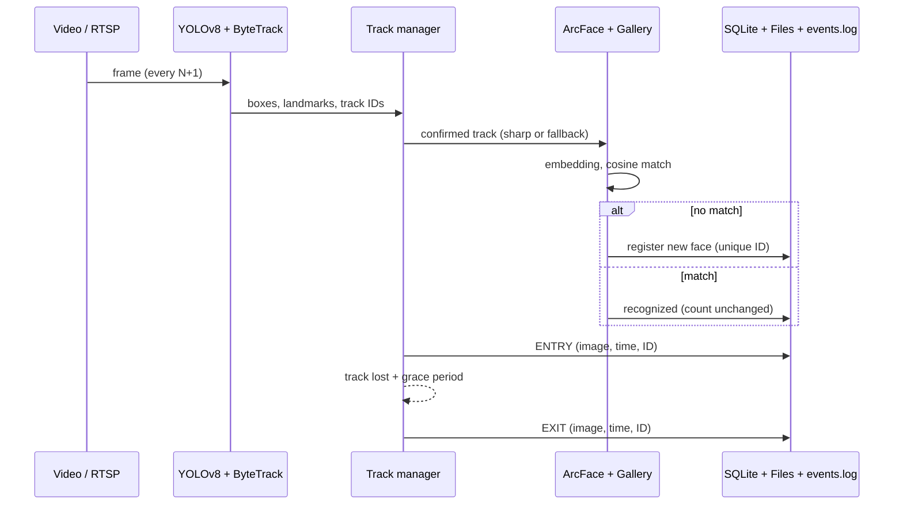
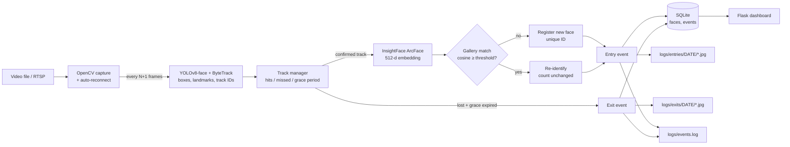

# Intelligent Face Tracker with Auto-Registration & Unique Visitor Counting

An AI-driven unique visitor counter. It reads a video file or a live RTSP stream, **detects**, **tracks** and **recognizes** faces in real time, **auto-registers** every new face, and logs **exactly one entry and one exit** per visit, each with a timestamped face crop. The total number of **unique visitors** is always available from the database.

> 🎥 **Demo video:** https://youtu.be/PMVT2QZDD1I

| Stage | Technology |
|---|---|
| Face detection | YOLOv8-face (Ultralytics) |
| Tracking | ByteTrack (built into Ultralytics) |
| Face recognition | InsightFace, ArcFace (`buffalo_l`, 512-d embeddings) |
| Database | SQLite (WAL mode) |
| Logging | `events.log` + local image store + database |
| Configuration | `config.json` |
| Dashboard (bonus) | Flask |
| Input | Video file (development)

---

## Table of contents
1. [Features](#1-features)
2. [How it works](#2-how-it-works)
3. [Architecture](#3-architecture)
4. [Setup & usage](#4-setup--usage)
5. [Configuration](#5-configuration)
6. [Logging system & output](#6-logging-system--output)
7. [Unique visitor counting](#7-unique-visitor-counting)
8. [AI planning document](#8-ai-planning-document)
9. [Compute load estimate](#9-compute-load-estimate)
10. [Reliability & resilience](#10-reliability--resilience)
11. [Assumptions & limitations](#11-assumptions--limitations)
12. [Troubleshooting & tuning](#12-troubleshooting--tuning)
13. [Project structure](#13-project-structure)
14. [Use of AI tools](#14-use-of-ai-tools)

---

## 1. Features
- **Real-time face detection** with YOLOv8-face; `frame_skip` in `config.json` controls how many frames are skipped between detection cycles.
- **Stable tracking** with ByteTrack, which keeps the same ID through short occlusions and missed detections.
- **State-of-the-art recognition**: ArcFace embeddings from 5-point aligned face crops (the `face_recognition` library is not used).
- **Automatic registration**: each new face gets a unique ID and is stored with metadata (ID, first-seen timestamp, embedding, image).
- **Re-identification**: a returning person is matched by cosine similarity, keeps the same ID, and does **not** increase the unique count.
- **Exactly one entry and one exit per visit**, with a grace period that stops entry/exit flicker.
- **Quality handling**: sharp crops are preferred, but a face that stays blurry is still registered after a few detections, so no visitor is missed.
- **Three-way logging**: `events.log`, cropped images in dated folders, and database rows.
- **Live dashboard** (bonus): unique count, entries, exits, recent events with images, registered faces.
- **Crash-safe**: every event is committed immediately; exits are flushed on shutdown; RTSP streams reconnect automatically.

## 2. How it works

For each detection cycle (every `frame_skip + 1` frames):

1. **Detect + track.** YOLOv8-face finds faces and their 5 landmarks; ByteTrack assigns each face a stable track ID.
2. **Confirm.** A track becomes a candidate after `min_confirm_hits` detections, which filters one-frame false positives.
3. **Embed.** The face is aligned to 112×112 using the landmarks and passed to ArcFace, which returns a normalized 512-d embedding. Sharp crops are preferred; a face that stays blurry is used after `blur_fallback_hits` detections.
4. **Match.** The embedding is compared with every registered face (cosine similarity).
   - Similarity ≥ `recognition_threshold` → **recognized**, existing face ID.
   - Otherwise → **registered** as a new face with a new unique ID.
5. **Entry.** One `entry` event is logged (image, timestamp, type, face ID). If the person was only briefly lost, the visit is **resumed** instead of logging a second entry.
6. **Track.** The face is followed frame to frame; tracking lines are written periodically to `events.log`.
7. **Exit.** When the track is lost and the person has not returned within `exit_grace_frames`, one `exit` event is logged. Remaining exits are flushed when the video ends or the program stops.



## 3. Architecture


**Database schema**

| Table | Columns |
|---|---|
| `faces` | `face_id` (PK), `first_seen`, `embedding` (512 floats), `image_path` |
| `events` | `event_id` (PK), `face_id` (FK), `event_type` (`entry`/`exit`), `timestamp`, `frame_idx`, `image_path` |

## 4. Setup & usage

**Requirements:** Python 3.10–3.12, Windows/Linux/macOS. A GPU is optional.

```bash
# 1. Create and activate a virtual environment
python -m venv venv
venv\Scripts\activate              # Mac/Linux: source venv/bin/activate

# 2. Install dependencies (GPU: swap onnxruntime for onnxruntime-gpu)
pip install -r requirements.txt

# 3. Download the YOLOv8-face weights into models/
python scripts/download_models.py   # InsightFace buffalo_l downloads itself on first run

# 4. Put the sample video in data/  (sample.mp4, or any .mp4/.avi/.mov: it is auto-detected)

# 5. Run (--reset wipes old DB + logs for a clean run)
python main.py --reset

# 6. Results
python main.py --report            # unique visitor count from the database
python dashboard.py                # live dashboard -> http://localhost:5000
python scripts/export_sample.py    # copy logs, DB dumps and images into sample_output/
python tests/test_logic.py         # simulated entry/exit/re-ID test (no models needed)
```

| Option | Effect |
|---|---|
| `python main.py` | Run on the source in `config.json` |
| `python main.py --reset` | Delete old database and logs, then run |
| `python main.py --report` | Print unique visitors and event totals |
| `"display": true` | Live window with boxes, IDs and the unique count (press `q` to quit) |
| `"device": "0"` | Use GPU 0 |

**RTSP camera (interview):** in `config.json` set
```json
"source": "rtsp://user:pass@ip:554/stream",
"is_stream": true
```
The system reconnects automatically if the stream drops.

## 5. Configuration

Sample `config.json`:
```json
{
  "source": "data/sample.mp4",
  "is_stream": false,
  "frame_skip": 1,
  "yolo_model": "models/yolov8n-face.pt",
  "detection_conf": 0.35,
  "min_face_size": 25,
  "min_sharpness": 15,
  "blur_fallback_hits": 4,
  "device": "cpu",
  "recognition_model": "buffalo_l",
  "recognition_threshold": 0.40,
  "max_missed_cycles": 10,
  "min_confirm_hits": 2,
  "exit_grace_frames": 60,
  "reconnect_delay_sec": 5,
  "log_dir": "logs",
  "db_path": "data/visitors.db",
  "display": false
}
```

| Key | Meaning |
|---|---|
| `source` / `is_stream` | Video path or RTSP URL; `is_stream: true` enables auto-reconnect |
| **`frame_skip`** | **Frames skipped between detection cycles** (0 = detect every frame) |
| `yolo_model` | Path to the YOLOv8-face weights |
| `detection_conf` | Minimum detector confidence (lower = more faces, more false positives) |
| `min_face_size` | Smallest face (pixels) to consider |
| `min_sharpness` | Laplacian-variance score; sharper crops are preferred for embeddings |
| `blur_fallback_hits` | A face that stays blurry is still registered after this many detections |
| `device` | `"cpu"` or a GPU index such as `"0"` |
| `recognition_model` | InsightFace model pack (`buffalo_l` = ArcFace R50) |
| `recognition_threshold` | Cosine similarity needed to call two faces the same person |
| `max_missed_cycles` | Detection cycles without a match before a track is lost |
| `min_confirm_hits` | Detections needed before a face is registered (filters false positives) |
| `exit_grace_frames` | Reappearing within this many frames counts as the same visit |
| `log_dir`, `db_path` | Output locations |
| `display` | Show the live annotated window |

## 6. Logging system & output

**Every entry and exit produces:** a cropped face image, a timestamp, the event type, and the face ID. These are stored on disk and in the database.

```
logs/
├── events.log                          # all critical system events
├── entries/YYYY-MM-DD/HH-MM-SS-mmm_id<N>_entry.jpg
├── exits/YYYY-MM-DD/HH-MM-SS-mmm_id<N>_exit.jpg
└── faces/YYYY-MM-DD/HH-MM-SS-mmm_id<N>_face.jpg   # registration crop
data/visitors.db                        # faces + events tables
```

`events.log` records: embedding generation, registration, recognition, merging/resuming, tracking, entry and exit. Format (example):
```
<time> | INFO | EMBEDDING generated | track=7 dim=512
<time> | INFO | REGISTERED new face | face_id=3 best_sim=0.211 total_unique=3
<time> | INFO | ENTRY | face_id=3 track=7 frame=120 img=logs/entries/<date>/...
<time> | INFO | TRACKING | face_id=3 track=7 hits=10 frame=150
<time> | INFO | RECOGNIZED | face_id=3 sim=0.612 track=15
<time> | INFO | RESUMED | face_id=3 (same visit, no new entry/exit)
<time> | INFO | EXIT | face_id=3 track=7 frame=240 img=logs/exits/<date>/...
<time> | INFO | FINAL unique visitors = ... | events={...}
```
Sample output from the provided video (logs, images and database dumps) is in [`sample_output/`](sample_output/).

## 7. Unique visitor counting
- The count is the number of rows in the `faces` table: `SELECT COUNT(*) FROM faces`.
- Re-identifying a known face never adds a row, so repeat appearances do not increase the count.
- Retrieve it any time: `python main.py --report`, the dashboard, or the `FINAL unique visitors` line at the end of `events.log`.
- Entries and exits are counted separately (`events` table), so you can compare visits against unique people.

## 8. AI planning document

**Goal:** count unique visitors from a video or RTSP stream with exactly one entry and one exit log per visit.

**Workflow followed:** define modules and data model → detector → embeddings and gallery → tracking and entry/exit state machine → logging (file + images + DB) → resilience → test on the sample video and tune thresholds → dashboard → documentation.

**Planned features:** detection with configurable frame skip · ByteTrack tracking · ArcFace embeddings · auto-registration · re-identification · entry/exit state machine with grace period · `events.log` + image store + database · unique count · crash-safe writes · RTSP reconnect · Flask dashboard.

**Design decisions**
- *Embedding once per track, not per frame:* the cheapest way to stay real-time.
- *Confirmation hits:* a face is only registered after several detections, which removes false positives.
- *Grace period:* brief tracking loss does not create fake exit/entry pairs.
- *Blur fallback:* quality is preferred, but a blurry visitor is never silently dropped.
- *SQLite with WAL and commit-per-event:* simple, local and crash-safe.

## 9. Compute load estimate

Assumptions: 640–1080p video, about 10–15 detection cycles per second.

| Component | CPU (4 cores) | GPU (RTX 3050 or better) |
|---|---|---|
| YOLOv8n-face + ByteTrack | ~25–50 ms per cycle (≈1 core) | ~4–8 ms, ~0.5 GB VRAM |
| ArcFace R50 (new tracks only) | ~40–80 ms per new face | ~5 ms |
| Database, file I/O, dashboard | < 5 ms | < 5 ms |
| **Total** | ≈1.5–2.5 cores, ≈1.5 GB RAM | < 15% GPU, ≈1 GB |

On CPU, raise `frame_skip` if the run falls behind real time; on GPU, `frame_skip` can be 0–1. These are estimates; measure on your own hardware.

## 10. Reliability & resilience
- **Database:** SQLite WAL mode, a commit after every write.
- **Restart-safe:** known faces are reloaded from the database, so IDs and the count continue correctly.
- **Shutdown-safe:** on end of video or Ctrl-C, pending exits are flushed so every entry has an exit.
- **RTSP:** reconnects automatically when the stream drops or is unavailable.
- **Log rotation:** `events.log` rotates at 10 MB.
- **Tests:** `tests/test_logic.py` simulates flicker, a re-appearing person and a second visitor, and checks the entry/exit/unique counts.

## 11. Assumptions & limitations
- Faces are at least `min_face_size` pixels; the YOLO face weights provide 5 landmarks (otherwise a padded-crop fallback with lower accuracy is used).
- An "exit" means the track was lost and the person did not return within `exit_grace_frames`. A later return logs a new entry with the **same** face ID.
- Timestamps are wall-clock time at processing; `frame_idx` is stored to correlate with video time.
- Masked, tilted, looking-down or very blurry faces are the hardest cases; thresholds (`recognition_threshold`, `min_sharpness`, `exit_grace_frames`) may need adjusting for other cameras.
- Identity is decided once per track at confirmation, not re-verified on every frame.
- Two people who look very similar can be merged if the threshold is too low; one person with poor-quality crops can get two IDs if it is too high.

## 12. Troubleshooting & tuning

| Problem | What to change |
|---|---|
| `Cannot open source` | Put the video in `data/` (it is auto-detected) or fix `source` in `config.json` |
| Faces are missed | Lower `detection_conf`, `min_face_size`, `min_confirm_hits`; set `frame_skip` to 0–1 |
| Same person gets several IDs | Lower `recognition_threshold` slightly (e.g. 0.35); raise `min_sharpness` |
| Different people share an ID | Raise `recognition_threshold` (e.g. 0.45) |
| Entry/exit flickers | Raise `exit_grace_frames` and `max_missed_cycles` |
| Too slow on CPU | Raise `frame_skip`, set `"display": false` |
| `unrecognized arguments: --reset` | `main.py` is outdated; use the latest version |
| `ModuleNotFoundError: src` in a script | Run from the project root; use `python -m scripts.export_sample` |

Change one setting at a time, run `python main.py --reset`, and compare the unique count with a manual count.

## 13. Project structure
```
face-tracker/
├── main.py                 # entry point: capture loop, reconnect, shutdown flush, --report/--reset
├── dashboard.py            # Flask dashboard (bonus)
├── config.json
├── requirements.txt
├── PROMPTS.md              # prompts used with AI tools
├── src/
│   ├── config.py           # config loading and validation
│   ├── detector.py         # YOLOv8-face + ByteTrack
│   ├── tracker.py          # track bookkeeping (hits, missed, lost)
│   ├── recognizer.py       # ArcFace embeddings + gallery matching
│   ├── pipeline.py         # detect → recognize → register → entry/exit logging
│   ├── database.py         # SQLite persistence
│   └── events_logger.py    # events.log setup
├── scripts/
│   ├── download_models.py
│   └── export_sample.py
├── tests/test_logic.py
├── logs/                   # events.log, entries/, exits/, faces/
├── data/                   # video + visitors.db
└── sample_output/          # evidence from the sample video
```

## 14. Use of AI tools
This project was built with AI code-generation tools following a plan → features → compute estimate → build → test → document workflow. The prompts used are listed in [`PROMPTS.md`](PROMPTS.md). The generated code was reviewed, tested on the sample video, and tuned (tracking, grace period, blur handling, thresholds).

---
This project is a part of a hackathon run by https://katomaran.com