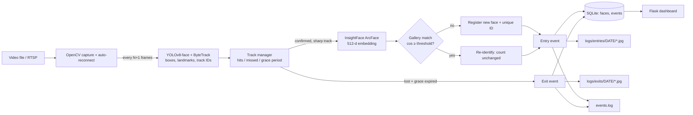

# Intelligent Face Tracker with Auto-Registration & Unique Visitor Counting

Real-time pipeline: **YOLOv8-face** (detection) → **ByteTrack** (tracking) → **InsightFace ArcFace** (512-d embeddings) → **SQLite + image store + events.log**, with a live **Flask dashboard**.
New faces are auto-registered, re-identified when they return (the unique count never double-increments), and every entry/exit is logged with a timestamped face crop.

## Setup
```bash
python -m venv venv
venv\Scripts\activate            # Mac/Linux: source venv/bin/activate
pip install -r requirements.txt  # GPU: replace onnxruntime with onnxruntime-gpu
python scripts/download_models.py   # YOLOv8-face weights -> models/ (InsightFace buffalo_l auto-downloads on first run)
# put the sample video in data/  (any .mp4/.avi/.mov; auto-detected if sample.mp4 is missing)
python main.py --reset           # clean run (wipes old DB + logs)
python main.py --report          # unique visitor count from DB
python dashboard.py              # live dashboard -> http://localhost:5000
python scripts/export_sample.py  # copy logs/DB dump/images into sample_output/
python tests/test_logic.py       # simulated test of entry/exit/re-ID logic (no models needed)
```
**RTSP (interview):** set `"source": "rtsp://user:pass@ip:554/stream"` and `"is_stream": true` in `config.json` (auto-reconnect on drop).
**GPU:** set `"device": "0"`. **Live window:** set `"display": true` (press `q` to quit).

## Sample `config.json`
```json
{
  "source": "data/sample.mp4",
  "is_stream": false,
  "frame_skip": 2,
  "yolo_model": "models/yolov8n-face.pt",
  "detection_conf": 0.5,
  "min_face_size": 40,
  "min_sharpness": 25,
  "blur_fallback_hits": 8,
  "device": "cpu",
  "recognition_model": "buffalo_l",
  "recognition_threshold": 0.40,
  "max_missed_cycles": 10,
  "min_confirm_hits": 3,
  "exit_grace_frames": 60,
  "reconnect_delay_sec": 5,
  "log_dir": "logs",
  "db_path": "data/visitors.db",
  "display": false
}
```
| Key | Meaning |
|---|---|
| `frame_skip` | **Frames skipped between detection cycles** (0 = every frame) |
| `recognition_threshold` | Cosine similarity ≥ this ⇒ same person (lower = fewer duplicate IDs, risk of merging people) |
| `min_confirm_hits` | Detections needed before a face is embedded/registered (filters false positives) |
| `min_sharpness` | Sharp crops are preferred for embeddings (blurry ones cause duplicate IDs) |
| `blur_fallback_hits` | A face that stays blurry is still registered after this many detections, so no visitor is missed |
| `max_missed_cycles` | Detection cycles without a match before a track is considered lost |
| `exit_grace_frames` | Re-appearing within this many frames = same visit (prevents entry/exit flicker) |

## 1. AI Planning Document
**Goal:** count unique visitors from a video/RTSP stream with exactly one entry and one exit log per appearance.

**Workflow:** define modules & data model → detector → embeddings + gallery → tracking & entry/exit state machine → logging (file + images + DB) → resilience → test on sample video and tune thresholds → dashboard → documentation.

**Features**
1. YOLOv8-face detection every `frame_skip+1` frames (config-driven).
2. ByteTrack for stable IDs across frames and short occlusions.
3. ArcFace (InsightFace buffalo_l) embeddings from 5-point aligned crops; blurry crops skipped.
4. Auto-registration: unique ID + metadata (ID, timestamp, embedding, image) stored in DB.
5. Re-identification via cosine similarity against the gallery; repeat visits never raise the count.
6. Entry on confirmation, exit after track loss + grace period; exactly one exit per entry (flushed on shutdown).
7. Logging: `logs/events.log` (embedding, registration, recognition, tracking, entry, exit), crops in `logs/entries|exits|faces/YYYY-MM-DD/`, metadata in SQLite.
8. Unique count = `SELECT COUNT(*) FROM faces` (`python main.py --report`).
9. Resilience: SQLite WAL + commit per event, gallery reload on restart, exit flush on Ctrl-C, RTSP auto-reconnect.
10. Bonus: live Flask dashboard (counts, recent events with images, registered faces).

**Compute estimate** (≈640–1080p, `frame_skip=2` ⇒ ~10 detection cycles/s at 30 FPS)
| Component | CPU (4-core) | GPU (RTX 3050+) |
|---|---|---|
| YOLOv8n-face + ByteTrack | ~25–50 ms/cycle (~1 core) | ~4–8 ms, ~0.5 GB VRAM |
| ArcFace R50 | ~40–80 ms per *new track* only | ~5 ms |
| DB / file IO / dashboard | <5 ms | <5 ms |
| **Total** | ~1.5–2.5 cores, ~1.5 GB RAM | <15% GPU, ~1 GB |
Embedding runs once per track, not per frame — the main saving. *(Estimates; measure on your hardware.)*

## 2. Architecture

```
face-tracker/
├── main.py  dashboard.py  config.json  requirements.txt
├── src/ config.py | detector.py | tracker.py | recognizer.py | pipeline.py | database.py | events_logger.py
├── scripts/ download_models.py | export_sample.py
├── tests/test_logic.py
├── logs/ events.log, entries/, exits/, faces/      data/visitors.db
└── sample_output/
```
**DB schema:** `faces(face_id, first_seen, embedding, image_path)`, `events(event_id, face_id, event_type[entry|exit], timestamp, frame_idx, image_path)`.

## Assumptions & limitations
- Faces ≥ `min_face_size` px; YOLO face weights provide 5 landmarks (otherwise a padded-crop fallback with lower accuracy is used).
- "Exit" = track lost and not seen again within `exit_grace_frames`; a later return logs a new entry with the **same** face ID.
- Timestamps are wall-clock at processing time; `frame_idx` is stored for video-time correlation.
- Masked, tilted or very blurry faces are the hardest cases; thresholds (`recognition_threshold`, `min_sharpness`, `exit_grace_frames`) were tuned on the sample video and may need adjusting for other cameras.
- Identity is decided once per track (at confirmation), not re-verified every frame.

## Sample output
Generated from the sample video and stored in `sample_output/` (events.log, events/faces CSV dumps, summary, sample images).

## Demo video
**Loom/YouTube link:** _<add your link here — required for review>_

---
This project is a part of a hackathon run by https://katomaran.com
